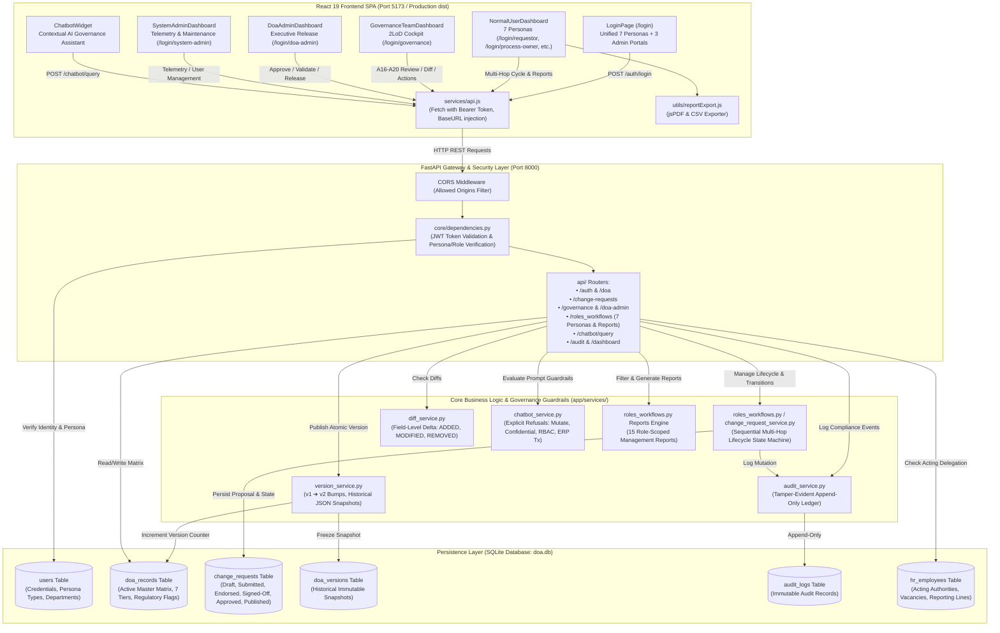

# Delegation of Authority (DOA) Governance Workflow Tool — Technical & Architectural Guide

This document provides a comprehensive technical overview of the **Delegation of Authority (DOA) Governance Workflow Prototype**, covering codebase hierarchy, data flow architecture, database schemas, API topology, multi-tier workflow cycles, governance guardrails, role-specific management reporting, AI Governance Assistant bot, and the end-to-end governance lifecycle.

---

## 1. Codebase Hierarchy Structure

```text
DOA/
├── frontend/                       # React 19 Frontend SPA (Vite + TailwindCSS v4)
│   ├── package.json                # Frontend dependencies (React 19, Lucide, TailwindCSS, Vite, jsPDF, XLSX)
│   ├── vite.config.js              # Vite bundler & dev server configuration
│   ├── tailwind.config.js          # Tailwind tokens (Protiviti navy/teal/slate theme)
│   ├── postcss.config.js           # PostCSS configuration
│   ├── index.html                  # Single-page application entry HTML
│   ├── public/                     # Static assets and favicon
│   ├── dist/                       # Production bundle (HTML, JS, CSS)
│   │
│   └── src/                        # Frontend Application Source
│       ├── main.jsx                # Root DOM mounting point
│       ├── index.css               # Global Tailwind utilities and base directives
│       ├── App.css                 # Custom component animations and layout styles
│       ├── App.jsx                 # Core orchestrator, RBAC routing, auth state & toast manager
│       │
│       ├── components/             # React View & Dashboard Components
│       │   ├── LoginPage.jsx       # Unified login with 7 Personas + 3 Admin consoles
│       │   ├── ChatbotWidget.jsx   # Contextual AI Governance Assistant (guardrails, RAG lookup)
│       │   └── dashboards/         # Dedicated Role-Based Landing Dashboards
│       │       ├── NormalUserDashboard.jsx       # 7-Persona Hub: Requestor, Process Owner, Dept Owner, Authority Owner, Reviewer, Approver, Audit Read-Only
│       │       ├── GovernanceTeamDashboard.jsx   # Second-line reviewer cockpit: A16-A20
│       │       ├── DoaAdminDashboard.jsx         # Executive delegation administrator cockpit
│       │       └── SystemAdminDashboard.jsx      # Telemetry, user management, ETL trigger
│       │
│       ├── utils/
│       │   └── reportExport.js     # Client-side multi-format exporter (CSV & jsPDF printable dossier)
│       │
│       ├── services/
│       │   └── api.js              # Centralized asynchronous HTTP client (Fetch, JWT bearer auth)
│       │
│       └── data/
│           └── initialDoaData.js   # Fallback mock taxonomy & bootstrap authority definitions
│
└── backend/                        # Backend REST API Service (Python FastAPI & SQLite)
    ├── requirements.txt            # Python dependencies (FastAPI, Uvicorn, SQLAlchemy, Pydantic, Jose, BCrypt, Pytest)
    ├── doa.db                      # Primary SQLite relational database
    ├── test_doa.db                 # Automated test isolated SQLite instance
    │
    └── app/                        # Application Package
        ├── main.py                 # FastAPI app entry point, CORS middleware, router registration
        │
        ├── core/                   # Core Security & Configuration
        │   ├── config.py           # Application settings, JWT secret, CORS origins, DB path, Groq/OpenAI keys
        │   ├── security.py         # Passlib password hashing (BCrypt) & python-jose JWT token generation
        │   └── dependencies.py     # FastAPI dependency injection (get_current_user, require_roles, require_persona)
        │
        ├── database/               # Relational Persistence Layer
        │   ├── database.py         # SQLAlchemy engine, SessionLocal factory, get_db dependency
        │   └── models.py           # ORM models: User, DOARecord, DOAVersion, ChangeRequest, AuditLog, HREmployee
        │
        ├── schemas/                # Pydantic Schemas & DTOs
        │   └── schemas.py          # Data validation schemas: User, Token, DOA, ChangeRequest, Diff, GovernanceAction, Reports, Chatbot
        │
        ├── services/               # Core Business Logic & Domain Services
        │   ├── doa_service.py              # DOA record CRUD, filter queries, archiving, and retirement
        │   ├── change_request_service.py   # Change request lifecycle: create, approve, reject, publish, audit logging
        │   ├── diff_service.py             # Field-level delta engine: compares current vs proposed (ADDED, MODIFIED, REMOVED)
        │   ├── version_service.py          # Master versioning engine, historical JSON snapshots, rollback inspection
        │   ├── audit_service.py            # Immutable compliance audit trail recorder
        │   └── chatbot_service.py          # AI Assistant RAG pipeline with regex guardrails and intent validation
        │
        ├── api/                    # Modular API Routers (Prefix: /api)
        │   ├── auth.py             # Authentication: POST /api/auth/login, GET /api/auth/me
        │   ├── doa.py              # DOA Records: GET /api/doa, GET /api/doa/{id}, POST /api/doa, DELETE /api/doa/{id}
        │   ├── change_requests.py  # Standard change request workflow & diff inspection
        │   ├── audit.py            # Audit trail querying: GET /api/audit (filterable by record_id, action)
        │   ├── dashboard.py        # Global metrics summary: GET /api/dashboard/summary
        │   ├── taxonomy.py         # Relational master data: functions, committees, governance docs, rules
        │   ├── normal_user.py      # Role-dedicated endpoints for Department Requesters
        │   ├── governance_team.py  # Role-dedicated endpoints for Governance Reviewers (A16-A20 actions)
        │   ├── doa_admin.py        # Role-dedicated endpoints for DOA Administrators (validation, release)
        │   ├── system_admin.py     # System telemetry, user management, and health checks
        │   ├── roles_workflows.py  # 7 Persona-dedicated hubs, sequential workflow transitions & 15 role management reports
        │   └── chatbot.py          # POST /api/chatbot/query AI Governance bot endpoint
        │
        ├── seed.py                 # Database bootstrap script (seeds 7 persona users + admins + 53 baseline records + HR employees)
        └── seed_doa_data.json      # Structured baseline dataset extracted from enterprise DOA matrix
```

---

## 2. End-to-End Data Flow Architecture

The following diagram illustrates the complete data flow across clients, authentication guards, business services, multi-tier workflows, reporting hubs, and persistence layers.



---

## 3. Governance Lifecycle & Multi-Hop Sequential Workflow Cycle

The system enforces a comprehensive **Two-Lines-of-Defense (2LoD)** governance model, ensuring that changes undergo sequential domain, operational, risk, and executive verification prior to atomic publication.

```text
┌────────────────────────────────────────────────────────────────────────────────────────────────────────┐
│                                 SEQUENTIAL WORKFLOW CYCLE (MULTI-HOP)                                 │
└────────────────────────────────────────────────────────────────────────────────────────────────────────┘
   [1. Requestor: FRONTEND_USER]
        │
        ▼ (POST /api/requestor/proposals ➔ Status: PENDING_PROCESS_OWNER or SUBMITTED)
   [2. Process Integrity Lead: PROCESS_OWNER]
        │   • Reviews Operational Impact Assessment & SOP alignment
        │   • Action: POST /api/process-owner/requests/{id}/endorse
        ▼ (Status: PENDING_DEPT_OWNER)
   [3. Function / Department Custodian: DEPT_OWNER]
        │   • Validates departmental budget limits & signing thresholds
        │   • Action: POST /api/dept-owner/requests/{id}/signoff
        ▼ (Status: PENDING_2LOD_REVIEW)
   [4. Governance Mandate Custodian: AUTHORITY_OWNER]
        │   • Inspects Board Charters, Terms of Reference & Committee Mandates
        │   • Action: POST /api/authority-owner/requests/{id}/verify-mandate
        ▼
   [5. Second-Line Risk Reviewer: REVIEWER / 2LoD]
        │   • Inspects technical diffs (Old vs New), regulatory citations
        │   • Action: POST /api/reviewer/requests/{id}/recommend
        ▼ (Status: UNDER_REVIEW)
   [6. Executive Approver: APPROVER / VP Finance]
        │   • Binding four-eye executive decision with mandatory rationale
        │   • Action: POST /api/approver/requests/{id}/decision?action=APPROVE
        ▼ (Status: APPROVED)
   [7. Release Authority: DOA_ADMINISTRATOR / GOVERNANCE_TEAM]
        │   • Pre-publication integrity verification & Optimistic Concurrency check
        │   • Action: POST /api/governance/requests/{id}/publish (or /doa-admin/publish)
        ▼ (Status: PUBLISHED)
   [Active Master DOA Matrix v(n+1) + Historical Frozen Snapshot in doa_versions]
```

### Detailed Workflow Stages & Transition Rules

1. **Proposal Initiation (`FRONTEND_USER`)**:
   - The user drafts an `ADD` (new rule), `MODIFY` (alter thresholds/tiers), or `DELETE` (retire rule) proposal.
   - Pre-submission validation evaluates mandatory taxonomy completeness and duplicate business lines.
   - The proposal captures `current_value`, locks `base_version`, and stores `proposed_value`.
   - The Requestor can withdraw a proposal via `POST /api/requestor/proposals/{cr_id}/withdraw` before binding approval.

2. **Process Integrity Review (`PROCESS_OWNER`)**:
   - The Process Owner accesses `/api/process-owner/queue` for operational workflows (e.g. Procure-to-Pay, Capex, Supply Chain).
   - Evaluates SOP alignment and records operational impact remarks.
   - Calling `/api/process-owner/requests/{cr_id}/endorse` advances status to `PENDING_DEPT_OWNER`.

3. **Departmental Supervisory Signoff (`DEPT_OWNER`)**:
   - The Department Owner reviews department-specific change requests via `/api/dept-owner/queue`.
   - Verifies departmental budget caps and organizational signing thresholds.
   - Calling `/api/dept-owner/requests/{cr_id}/signoff` advances status to `PENDING_2LOD_REVIEW`.

4. **Charter & Mandate Verification (`AUTHORITY_OWNER`)**:
   - The Authority Owner verifies alignment against Board Charters, Audit Committee Mandates, and GCEO delegations.
   - Verifies terms of reference via `/api/authority-owner/requests/{cr_id}/verify-mandate`.

5. **Second-Line Technical Risk Review (`REVIEWER` — 2LoD)**:
   - Evaluates `/api/reviewer/diff/{cr_id}` for attribute-level discrepancies.
   - Highlights changes across Financial Thresholds, Authority Operators (`A`, `E`, `R`, `P`, `N`), and Regulatory References.
   - Calling `/api/reviewer/requests/{cr_id}/recommend` transitions status to `UNDER_REVIEW`.

6. **Executive Binding Approval (`APPROVER`)**:
   - The Executive Approver reviews the inbox via `/api/approver/inbox`.
   - Issues a binding `APPROVE` or `REJECT` decision with obligatory rationale comments via `/api/approver/requests/{cr_id}/decision`.
   - Transitions status to `APPROVED` or `REJECTED`. Approved proposals do **not** immediately overwrite live matrix records.

7. **Controlled Publication (`DOA_ADMINISTRATOR` / `GOVERNANCE_TEAM` — A20)**:
   - Validates that the request status is strictly `APPROVED`.
   - **Optimistic Concurrency Protection**: If `target_doa.current_version != cr.base_version`, publication is rejected with `HTTP 409 Conflict`.
   - **Atomic Master Version Increment**:
     - Archives the current active record to `doa_versions` with status `HISTORICAL`.
     - Increments the version counter ($v_n \rightarrow v_{n+1}$).
     - Applies changes to `doa_records`.
     - Freezes a new snapshot in `doa_versions` with status `PUBLISHED`.
     - Transitions change request status to `PUBLISHED` and appends an immutable `PUBLISH_CHANGE` audit log.

---

## 4. Governance Guardrails & System Defenses

The system implements multiple concentric guardrails across security, data segregation, workflow integrity, and AI assistant interaction.

### 4.1 Strict AI Assistant Guardrails (`app/services/chatbot_service.py`)
The DOA Assistant bot adheres to strict refusal guardrails evaluated via deterministic pattern matchers before engaging LLM inference:

| Guardrail Category | Protected Scope | Refusal Response Strategy |
| :--- | :--- | :--- |
| **1. Action Execution Refusal** | Approving, rejecting, creating, editing, deleting, or retiring DOA rules or change requests. | **Refusal:** Assistant is read-only and explicitly directs users to the appropriate review queue or proposal modal. |
| **2. Confidentiality & Speculation Refusal** | In-progress deliberation notes, private clarification threads, speculation on approval outcomes. | **Refusal:** Refuses disclosure of private notes; refuses speculation; clarifies that 2LoD reviewers and executive approvers decide outcomes. |
| **3. RBAC & Security Refusal** | Role elevation, password resets, accessing database secrets, JWT keys, or technical configs. | **Refusal:** Clarifies that role modifications are governed exclusively by System Administrators and system secrets are inaccessible. |
| **4. Operational ERP Transactions** | Live vendor payments, purchase order status, invoice processing, disbursement queries. | **Refusal:** Explicitly clarifies that the DOA framework defines authority limits and decision rules, not operational ERP invoice transactions. |

### 4.2 Optimistic Concurrency Control (OCC)
- Every change proposal locks the `base_version` of the target master record at initiation.
- Upon publication, the engine verifies `live_version == cr.base_version`.
- Any intermediate concurrent update returns **HTTP 409 Conflict**, preventing race conditions or accidental overwrite of concurrent updates.

### 4.3 Segregation of Duties (SoD) & 4-Eye Principle
- **Self-Approval Guard**: An author cannot approve their own change request (`requester_id != reviewer_id`).
- Detected via automated audit reports (`RPT-AUD-03: Segregation of Duties Exception Report`).
- Staged hand-offs require separate identities between Requestor, Endorser, Reviewer, and Approver.

### 4.4 Tamper-Evident Immutable Audit Ledger
- All mutations (creations, endorsements, sign-offs, approvals, rejections, clarifications, re-routings, escalations, publications, and archival) append to `audit_logs`.
- Audit logs contain UTC timestamps, user email, actor role, entity ID, action type, old JSON snapshot, new JSON snapshot, and decision comment.
- Deletion or modification of audit log records is structurally prohibited.

---

## 5. Pre-Set Role-Specific Management Reports Hub

The platform delivers a dedicated **Management Reports Hub** provisioned with **15 specialized pre-set reports** tailored to specific persona responsibilities:

| Report ID | Report Title | Target Persona | Scope & Aggregations |
| :--- | :--- | :--- | :--- |
| **`RPT-USR-01`** | **Personal Proposal Lifecycle & Status Report** | `FRONTEND_USER` (Requestor) | Tracks all proposals initiated by user across lifecycle stages. |
| **`RPT-USR-02`** | **Department Operational Limits Matrix** | `FRONTEND_USER` (Requestor) | Active published delegations scoped to requester's departmental domain. |
| **`RPT-PO-01`** | **End-to-End Operational Process Alignment** | `PROCESS_OWNER` | Process taxonomy alignment across P2P, Capex, and operational flows. |
| **`RPT-PO-02`** | **Pending Operational Impact Queue & SLA Telemetry** | `PROCESS_OWNER` | SLA tracking (>48h bottleneck telemetry) for operational impact queues. |
| **`RPT-DO-01`** | **Departmental Delegated Signing Limits Matrix** | `DEPT_OWNER` | Tiered signing authority limits ($100K / $500K / Board) for departmental domain. |
| **`RPT-DO-02`** | **Departmental Rule Revision & Version History** | `DEPT_OWNER` | Historical version modifications ($v > 1$) within the department. |
| **`RPT-AO-01`** | **Corporate Governance Charter Mandate Matrix** | `AUTHORITY_OWNER` | Board of Directors, Audit Committee, and Executive terms of reference. |
| **`RPT-AO-02`** | **Composite Multi-Tier Authority Chain Flow** | `AUTHORITY_OWNER` | Multi-tier ratification flows and statutory approvals. |
| **`RPT-REV-01`**| **Regulatory Mandated Authorities Register** | `REVIEWER` (2LoD Risk) | Authorities flagged `regulatory == 'Y'` citing statutory codes and Central Bank rules. |
| **`RPT-REV-02`**| **Technical Diff Discrepancy & Concurrency Report** | `REVIEWER` (2LoD Risk) | Active proposals with field-level Old ➔ New delta and staleness checks. |
| **`RPT-APP-01`**| **Executive Approval Portfolio & High-Risk Exposure** | `APPROVER` (VP Finance) | High-exposure delegations (`key_non_key == 'Key'`) requiring Board/CEO sign-off. |
| **`RPT-APP-02`**| **Executive Binding Decisions Audit Rationale Report** | `APPROVER` (VP Finance) | Audit trail of all binding approval and rejection decisions with recorded rationale. |
| **`RPT-AUD-01`**| **DOA Master Rule Complete Version Snapshot Dossier**| `AUDIT_READONLY` | Comprehensive version archive ($v1, v2, \dots$) with complete JSON snapshots. |
| **`RPT-AUD-02`**| **Tamper-Evident Immutable Audit Trail Ledger** | `AUDIT_READONLY` | Append-only transaction log across all enterprise governance mutations. |
| **`RPT-AUD-03`**| **Segregation of Duties (SoD) Exception Report** | `AUDIT_READONLY` | Automated detection of 4-eye workflow adherence and self-approval violations. |

---

## 6. Key Relational Database Entities

| Table Name | Purpose | Primary Key | Key Foreign Keys / Indexed Attributes |
| :--- | :--- | :--- | :--- |
| **`users`** | Authentication credentials, full names, active statuses, RBAC roles, and persona types (`FRONTEND_USER`, `PROCESS_OWNER`, `DEPT_OWNER`, `AUTHORITY_OWNER`, `REVIEWER`, `APPROVER`, `AUDIT_READONLY`). | `id` (Integer) | `email` (Unique, Index), `persona_type`, `department` |
| **`doa_records`** | Active, legally binding Delegation of Authority master matrix. Preserves all 7 authority tiers, regulatory flags, and current version numbers. | `id` (String) | `status`, `parent_function`, `business_line`, `key_non_key`, `regulatory` |
| **`change_requests`**| Formal change governance proposals. Stores `current_value` snapshot, `proposed_value` changes, `base_version`, status, requester, reviewer, operational impact, and attachments. | `id` (String, e.g. `CR-0001`) | `doa_id` $\rightarrow$ `doa_records.id`, `requester_id` $\rightarrow$ `users.id`, `reviewer_id` $\rightarrow$ `users.id` |
| **`doa_versions`** | Historical version repository. Stores frozen full JSON snapshots of past published records for rollback inspection and compliance auditing. | `id` (Integer) | `doa_id` $\rightarrow$ `doa_records.id`, `version_number`, `status` |
| **`audit_logs`** | Append-only compliance log recording every action, user email, entity, timestamp, old JSON, new JSON, and decision comments. | `id` (Integer) | `record_id`, `action`, `timestamp`, `user_email` |
| **`hr_employees`** | Organizational employee directory storing designations, vacancy statuses, reporting hierarchies, and temporary acting authority delegations. | `id` (Integer) | `emp_code` (Unique), `email` (Unique), `doa_designation_key` |

---

## 7. User Roles, Personas & Permission Matrix

The platform bridges foundational RBAC with persona-based workflows:

| Role / Persona Key | Default Workspace | Primary Mandate | Permitted Workflows & Actions |
| :--- | :--- | :--- | :--- |
| **`FRONTEND_USER`** (Requestor) | `/login/requestor` | Business Line Analyst | Search published matrix, draft ADD/MODIFY/DELETE proposals, track personal submission lifecycle, withdraw pending requests. |
| **`PROCESS_OWNER`** | `/login/process-owner` | Process Integrity & Operational Lead | Monitor operational queues (P2P/Capex), record Operational Impact Assessments, endorse and advance proposals to Department Owner. |
| **`DEPT_OWNER`** | `/login/dept-owner` | Function / Department Custodian | Review departmental proposals, verify delegated signing limits and budget caps, issue departmental supervisory sign-off. |
| **`AUTHORITY_OWNER`** | `/login/authority-owner` | Mandate & Charter Custodian | Inspect composite authority matrix, verify compliance against Board Charters, Audit Committee Mandates, and GCEO delegations. |
| **`REVIEWER`** (2LoD Risk) | `/login/reviewer` | Risk & Policy Review Analyst | Inspect technical field-level diffs, verify regulatory compliance, record formal 2LoD risk recommendations, forward to Executive Approver. |
| **`APPROVER`** | `/login/approver` | Executive Approver (VP Finance) | Executive inbox, evaluate high-value exposures, make binding APPROVE or REJECT decisions with obligatory rationale. |
| **`AUDIT_READONLY`** | `/login/audit` | Internal Audit & Assurance | Full read-only access to master matrix, complete historical version dossiers, immutable audit ledger, and SoD exception tracking. |
| **`GOVERNANCE_TEAM`** | `/login/governance` | Central Governance Reviewer | Central review queue triage (A16), diff inspection (A17/A18), clarification requests, stakeholder tagging, re-routing, escalations (A19), controlled publication (A20). |
| **`DOA_ADMINISTRATOR`** | `/login/doa-admin` | Chief Delegation Officer | Full master matrix CRUD, pre-submission schema validation, approve/reject change requests, publish master versions ($v1 \rightarrow v2$), archive/retire authority records. |
| **`SYSTEM_ADMINISTRATOR`**| `/login/system-admin` | Platform Engineer / DBA | User management, credential updates, backend telemetry monitoring, ETL synchronization triggers, and database maintenance. |

