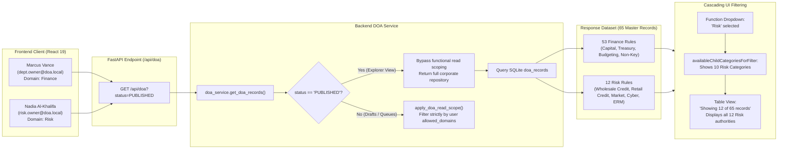
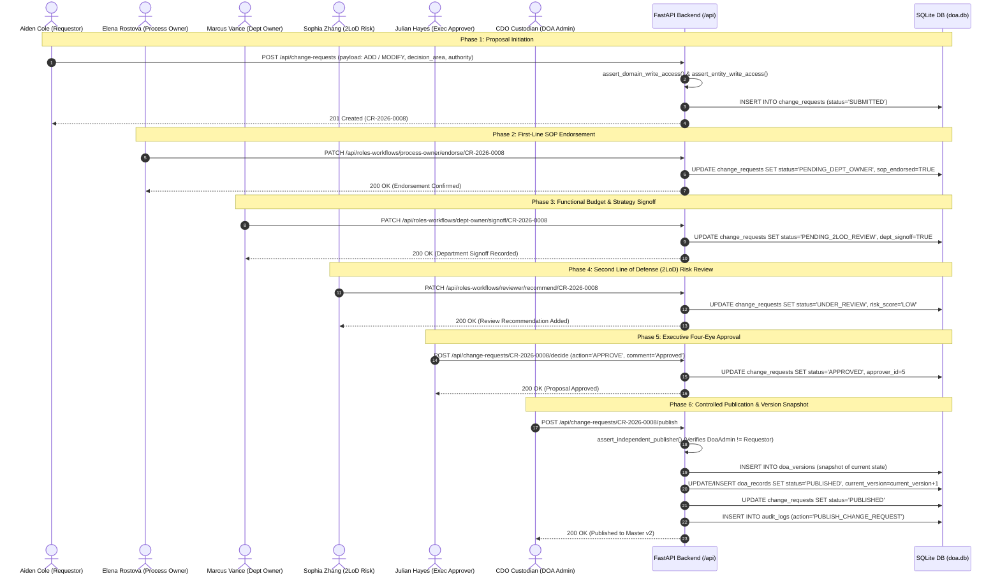
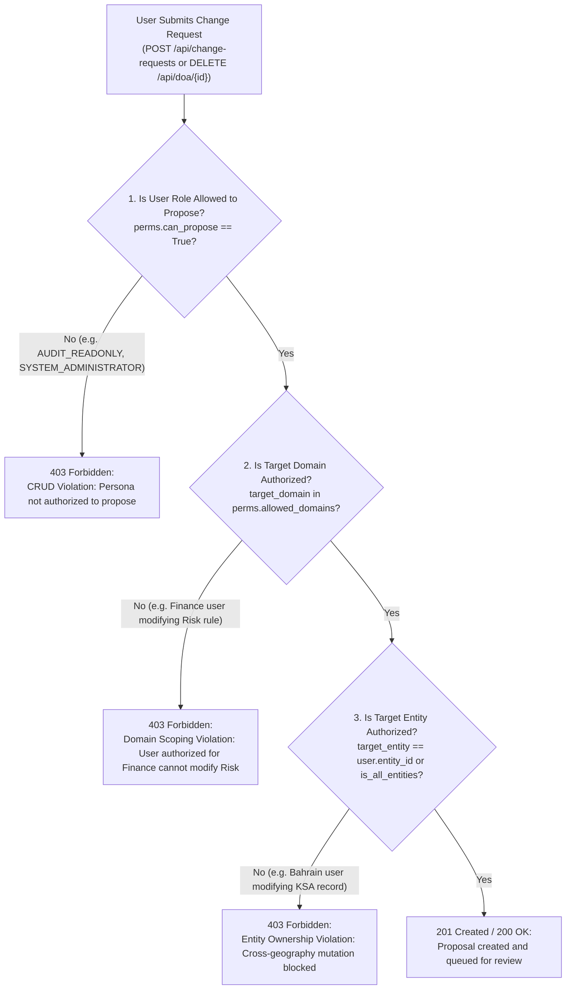

# Delegation of Authority (DOA) Governance Platform
## Updated Data Execution Flow & Testing Lifecycle Specification

**Document Reference:** `updated_flow.md`  
**Target Codebase:** `DOA---edge-cases` (FastAPI Backend + React 19 / Vite Frontend)  
**Last Updated:** November 2026  
**Purpose:** End-to-end data execution flowchart and testing specification for manual QA, automated regression testing, and verification of functional domain rules, read/write boundaries, and multi-tier governance workflows.

---

## 1. High-Level Data Execution Flow Architecture

This flowchart captures the unified lifecycle of data inside the DOA platform: from authentication and persona-based domain scoping, through corporate matrix exploration, to change proposal submission, multi-hop governance signoffs, and live version publication.

```mermaid
flowchart TD
    subgraph AUTH["1. Authentication & Session Initialization"]
        A1["User Enters Credentials"] --> A2["POST /api/auth/login"]
        A2 --> A3["Issue JWT Bearer Token"]
        A3 --> A4["Load User Profile & Permissions<br/>(allowed_domains, persona_type, role)"]
    end

    subgraph READ_PATH["2. Corporate Matrix Explorer (Read Pathway)"]
        A4 --> R1["GET /api/doa?status=PUBLISHED"]
        R1 --> R2["doa_service.get_doa_records()<br/>(All published records accessible)"]
        R2 --> R3["Load 65 Master Rules<br/>(53 Finance + 12 Risk)"]
        R3 --> R4["Filter 1: Parent Function<br/>(All Functions / Finance / Risk)"]
        R4 --> R5["Filter 2: Business Line / Risk Factor<br/>(Cascades dynamically to child categories)"]
        R5 --> R6["Filter 3: Full-text Search<br/>(Decision area, authority chain, comments)"]
        R6 --> R7["Render Filtered Governance Grid"]
        R7 --> R8["Inspect Row: GET /api/doa/{record_id}<br/>(Detail Drawer: 200 OK across all functions)"]
    end

    subgraph WRITE_PATH["3. Proposal Creation & Domain Security Gate"]
        R8 -.-> W1["Click Propose Add / Modify / Delete"]
        W1 --> W2{"canMutateRecord() Check<br/>Record Domain == User allowed_domains?"}
        W2 -- "No (Cross-Domain Mutation)" --> W3["Action Blocked in UI & Backend<br/>(403 Forbidden: Domain Scoping Violation)"]
        W2 -- "Yes (Authorized Domain)" --> W4["Interactive Authority Chain Builder"]
        W4 --> W5["POST /api/change-requests"]
        W5 --> W6["assert_domain_write_access()<br/>assert_entity_write_access()"]
        W6 --> W7["Create Record in change_requests<br/>Status: SUBMITTED"]
    end

    subgraph GOV_FLOW["4. Multi-Hop Governance Signoff Sequence"]
        W7 --> G1["Process Owner Endorsement<br/>PATCH /api/roles-workflows/process-owner/endorse/{cr_id}"]
        G1 --> G2["Status: PENDING_DEPT_OWNER"]
        G2 --> G3["Department Owner Signoff<br/>PATCH /api/roles-workflows/dept-owner/signoff/{cr_id}"]
        G3 --> G4["Status: PENDING_2LOD_REVIEW"]
        G4 --> G5["2LoD Risk Reviewer Recommendation<br/>PATCH /api/roles-workflows/reviewer/recommend/{cr_id}"]
        G5 --> G6["Status: UNDER_REVIEW"]
        G6 --> G7["Executive Approver Evaluation<br/>POST /api/change-requests/{cr_id}/decide"]
        G7 --> G8{"Executive Decision?"}
        G8 -- "REJECT (with Mandatory Rationale)" --> G9["Status: REJECTED<br/>Audit trail logged & requester notified"]
        G8 -- "APPROVE" --> G10["Status: APPROVED<br/>Awaiting Controlled Publication"]
    end

    subgraph PUB_ENGINE["5. Controlled Master Publication Engine"]
        G10 --> P1["POST /api/change-requests/{cr_id}/publish"]
        P1 --> P2{"assert_independent_publisher()<br/>Publisher != Requester (SoD Guardrail)?"}
        P2 -- "Failed: Self-Publication" --> P3["403 Forbidden: Segregation of Duties Violation"]
        P2 -- "Passed" --> P4["Create Version Snapshot (DOAVersion v(n+1))"]
        P4 --> P5["Update Master Repository (DOARecord)"]
        P5 --> P6["Status: PUBLISHED"]
        P6 --> P7["Write Immutable Audit Ledger Entry"]
        P7 --> R1
    end
```



---

## 2. Matrix Explorer Read & Filtering Execution Flow

> [!NOTE]
> Published corporate DOA rules are visible organization-wide in read-only mode so that any operational employee (e.g. Finance personnel verifying Risk thresholds, or Risk personnel checking Treasury capital authority) can inspect the current active governance boundaries. Mutation rights, however, remain strictly isolated to the functional department owner.



---

## 3. Change Proposal & Multi-Tier Governance Sequence

The diagram below details the exact sequence of HTTP calls, payload exchanges, and database state transitions for end-to-end testing of a Change Request.



---

## 4. Security & Mutation Scoping Execution Flow

This chart explains the exact security validation logic executed whenever a user attempts to mutate (propose changes or delete) a record.



---

## 5. End-to-End Test Scenarios & Execution Data

### Scenario 1: Cross-Functional Matrix Explorer Verification (Read-Only)

* **Objective:** Verify that any operational employee can explore and read published DOA records across all business functions (Finance can read Risk, Risk can read Finance).
* **Test Personas:**
  * **Marcus Vance** (`dept.owner@doa.local` / `User@123`) — Domain: **Finance**
  * **Nadia Al-Khalifa** (`risk.owner@doa.local` / `User@123`) — Domain: **Risk**
* **Execution Steps:**
  1. Log in as **Marcus Vance** (`dept.owner@doa.local`).
  2. Navigate to the **Search DoA** tab (`DOA Matrix Explorer`).
  3. Observe the counter badge: Expected **`Showing 65 of 65 records`**.
  4. In the **Function** dropdown, select **Risk**:
     * Observe the child dropdown **Business Line / Risk Factor** automatically updates to display all 10 Risk categories:
       * *Wholesale Credit Risk*
       * *Retail Credit Risk*
       * *Market & Treasury Risk*
       * *Operational & Non-Financial Risk*
       * *Liquidity & Asset-Liability Risk*
       * *Enterprise Risk Management (ERM)*
       * *Compliance & Financial Crime (AML/CFT)*
       * *Information Security & Cyber Risk*
       * *Shariah Governance Risk*
       * *Special Assets & Provisioning*
       * *Enterprise Risk Governance*
     * Counter badge updates to: **`Showing 12 of 65 records`**.
     * The table displays all 12 published Risk authority items (records `301` through `311`, `997`).
  5. Click on record **`301`** (*Approve wholesale single obligor credit limit above USD 50 million*):
     * Detail drawer opens with full authority matrix, approval chains, and governance citations.
     * Verify status code on network call `GET /api/doa/301` is **`200 OK`** (not 403 Forbidden).
  6. Switch user account to **Nadia Al-Khalifa** (`risk.owner@doa.local`).
  7. Select **Function = Finance**:
     * Counter badge updates to: **`Showing 53 of 65 records`**.
     * All 53 Finance records render cleanly in read-only mode.

---

### Scenario 2: Cross-Functional Mutation Prevention (Write Gate)

* **Objective:** Ensure Marcus Vance (Finance) cannot initiate proposals or modify Risk records, maintaining strict governance boundaries.
* **Execution Steps:**
  1. Logged in as **Marcus Vance** (`dept.owner@doa.local`).
  2. Select record **`301`** (Risk domain).
  3. Notice that the **Propose Modification** and **Propose Deletion** buttons are disabled/hidden because `canMutateRecord()` detects `parentFunction === 'Risk'`.
  4. Open Swagger UI / REST Client and simulate an unauthorized API POST call:
     ```http
     POST /api/change-requests
     Authorization: Bearer <marcus_vance_token>
     Content-Type: application/json

     {
       "doa_id": "301",
       "request_type": "MODIFY",
       "target_domain": "Risk",
       "reason": "Unauthorized attempt to amend Wholesale Credit limit",
       "proposed_changes": {
         "composite_authority": "CEO (A)"
       }
     }
     ```
  5. **Expected Result:**
     * HTTP Response: **`403 Forbidden`**
     * Response Body:
       ```json
       {
         "detail": "Domain Scoping Violation: User authorized for ['Finance'] cannot create or modify 'Risk' decision areas."
       }
       ```

---

### Scenario 3: Complete Happy-Path Proposal to Master Publication

* **Objective:** Execute a full 6-stage lifecycle for an authorized proposal from submission to live v(n+1) publication.
* **Test Sequence & Payloads:**

| Stage | Actor | Route / Endpoint | Action & Payload | Expected Status |
|---|---|---|---|---|
| **1. Submit** | Aiden Cole (`user@doa.local`) | `POST /api/change-requests` | `{"parent_function": "Finance", "business_line": "Treasury & Capital Management", "decision_area": "Approve short-term repo funding lines up to $100M", "key_non_key": "Key", "regulatory": "Y", "composite_authority": "ALCO (A) ➔ BoD (N)", "reason": "Liquidity enhancement"}` | `201 Created`<br/>Status: `SUBMITTED` |
| **2. SOP Endorse** | Elena Rostova (`process.owner@doa.local`) | `PATCH /api/roles-workflows/process-owner/endorse/{cr_id}` | `{"comment": "P2P SOP alignment verified"}` | `200 OK`<br/>Status: `PENDING_DEPT_OWNER` |
| **3. Dept Signoff** | Marcus Vance (`dept.owner@doa.local`) | `PATCH /api/roles-workflows/dept-owner/signoff/{cr_id}` | `{"comment": "Finance departmental budget signed off"}` | `200 OK`<br/>Status: `PENDING_2LOD_REVIEW` |
| **4. 2LoD Review** | Sophia Zhang (`reviewer@doa.local`) | `PATCH /api/roles-workflows/reviewer/recommend/{cr_id}` | `{"comment": "Risk appetite limits verified", "risk_rating": "LOW"}` | `200 OK`<br/>Status: `UNDER_REVIEW` |
| **5. Executive Decision** | Julian Hayes (`approver@doa.local`) | `POST /api/change-requests/{cr_id}/decide` | `{"action": "APPROVE", "comment": "Four-eye governance approval granted"}` | `200 OK`<br/>Status: `APPROVED` |
| **6. Publish** | CDO Custodian (`doaadmin@doa.local`) | `POST /api/change-requests/{cr_id}/publish` | `{}` | `200 OK`<br/>Status: `PUBLISHED`<br/>Master Version increments |

---

### Scenario 4: Executive Rejection with Obligatory Rationale

* **Objective:** Test the governance rejection branch and verify that rejections without rationale are blocked.
* **Execution Steps:**
  1. Create a proposal reaching `UNDER_REVIEW` state.
  2. Log in as **Julian Hayes** (`approver@doa.local`).
  3. Click **Reject Proposal** without entering comments.
  4. **Expected Result:** UI validation prevents submission; button remains disabled.
  5. Enter mandatory rationale: `"Rejected: Exceeds Group Credit risk appetite under current Q4 macroeconomic guidance."`
  6. Click **Confirm Rejection**.
  7. **Expected Result:**
     * Status updates to **`REJECTED`**.
     * Proposal is archived in Change Queue with red status badge.
     * Master DOA repository remains unmodified.

---

### Scenario 5: Segregation of Duties (SoD) Self-Publication Guardrail

* **Objective:** Verify that an administrator cannot approve or publish their own change request.
* **Execution Steps:**
  1. Log in as **Global Governance Administrator** (`admin@doa.local`).
  2. Create a change proposal `CR-SELF-01`.
  3. Attempt to publish `CR-SELF-01` using `POST /api/change-requests/CR-SELF-01/publish`.
  4. **Expected Result:**
     * HTTP Response: **`403 Forbidden`**
     * Error Message: `"Segregation of Duties Violation: Requester cannot self-publish their own Change Request."`
  5. Log in as **Second DOA Administrator** (`doaadmin@doa.local`).
  6. Execute publication:
     * HTTP Response: **`200 OK`** (Dual-control verification successful).

---

## 6. Testing Persona Credentials Reference

| Persona Role | User Name | Email | Password | Allowed Domain | Entity Scope |
|---|---|---|---|---|---|
| **Requestor (Front-End User)** | Aiden Cole | `user@doa.local` | `User@123` | `Finance` | `ENT-BH-01` |
| **Process Owner** | Elena Rostova | `process.owner@doa.local` | `User@123` | `Finance` | `ENT-BH-01` |
| **Department Owner (Finance)** | Marcus Vance | `dept.owner@doa.local` | `User@123` | `Finance` | `ENT-BH-01` |
| **Department Owner (Risk)** | Nadia Al-Khalifa | `risk.owner@doa.local` | `User@123` | `Risk` | `ENT-BH-01` |
| **Department Owner (KSA)** | Faisal Al-Saud | `ksa.owner@doa.local` | `User@123` | `Finance` | `ENT-KSA-02` |
| **Authority Owner** | David Sterling | `authority.owner@doa.local` | `User@123` | `ALL` | `ALL` |
| **Reviewer (2LoD Risk)** | Sophia Zhang | `reviewer@doa.local` | `User@123` | `ALL` | `ALL` |
| **Executive Approver** | Julian Hayes | `approver@doa.local` | `User@123` | `ALL` | `ALL` |
| **Audit Read-Only** | Claire Montgomery | `audit.readonly@doa.local` | `User@123` | `ALL` | `ALL` |
| **Governance Team** | Risk & Governance Reviewer | `governance@doa.local` | `GovTeam@123` | `ALL` | `ALL` |
| **DOA Administrator (CDO)** | Chief Delegation Officer | `doaadmin@doa.local` | `DoaAdmin@123` | `ALL` | `ALL` |
| **Global Admin** | Global Governance Admin | `admin@doa.local` | `Admin@123` | `ALL` | `ALL` |
| **System Administrator** | IT & System Admin | `sysadmin@doa.local` | `SysAdmin@123` | `ALL` | `ALL` |

